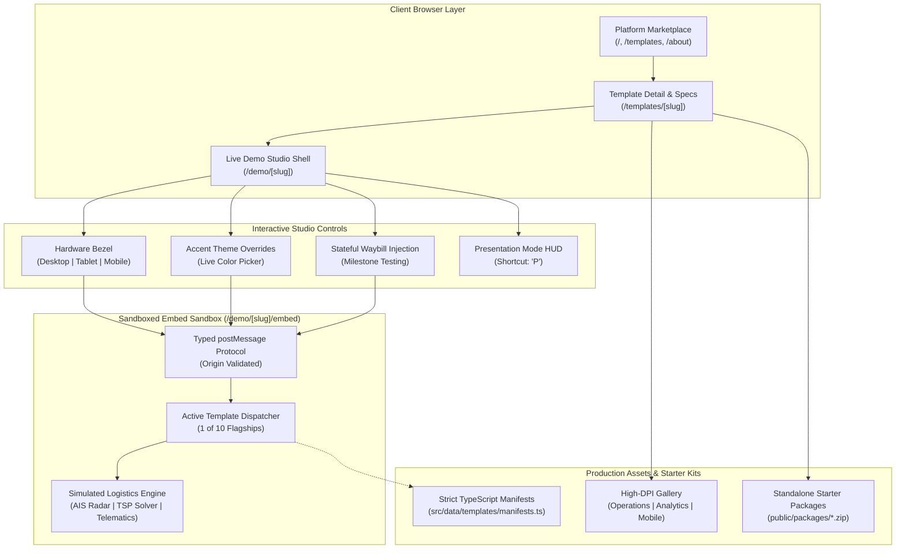
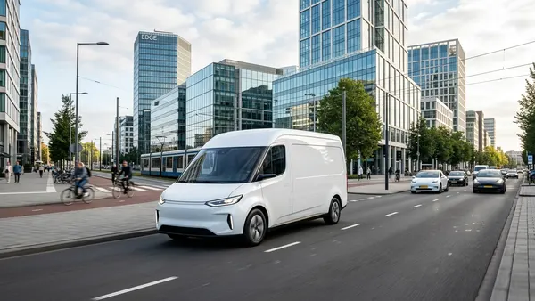
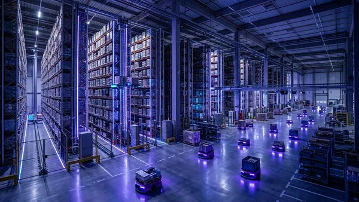
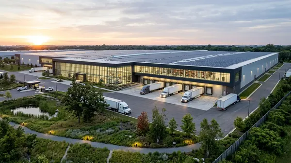
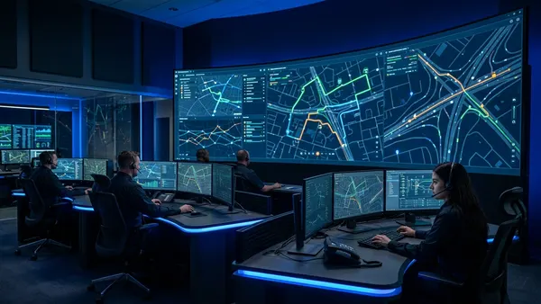
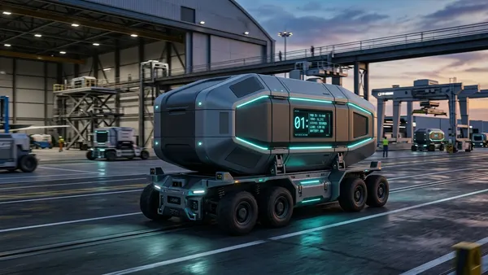

<div align="center">

# ⚡ LOGIFORGE
### Commercial Logistics Website Template Platform, Live Device Studio & Developer Starter Kits

[](https://nextjs.org/)
[](https://react.dev/)
[](https://www.typescriptlang.org/)
[](https://github.com/Vijay07012006/LOGIFORGE/releases/tag/v1.0.0)
[](https://logiforge-hazel.vercel.app)
[](./docs/reports/)
[](./LICENSE)

<p align="center">
  A category-defining digital SaaS template marketplace, responsive hardware preview studio, and production starter ecosystem engineered specifically for global freight forwarders, maritime shipping lines, air cargo fleets, automated port terminals, and supply chain enterprises.
</p>

[Live Marketplace](https://logiforge-hazel.vercel.app) • [System Architecture](./docs/ARCHITECTURE.md) • [Template Development](./docs/TEMPLATE_DEVELOPMENT.md) • [Security Policy](./docs/SECURITY.md) • [Audit Reports](./docs/reports/) • [License](./LICENSE)

</div>

---

## 🌟 1. Overview & Vision

**LOGIFORGE** replaces generic, uninspired web templates with purpose-built, high-performance web applications designed for the international logistics and transportation sector.

Built with an ultra-premium dark luxury aesthetic, incandescent tandoori orange accents, and warm golden amber highlights, LOGIFORGE solves a fundamental agency and enterprise problem: **custom logistics portals take 8–16 weeks of ground-up engineering** to design tokens, wire stateful milestone trackers, and validate multi-device responsiveness. LogiForge cuts that timeline down to **1–2 weeks** with 10 production-tested, fully typed website architectures.

### What Makes LogiForge World-Class?
- **10 Flagship Logistics Architectures**: Covering Freight Forwarding, Heavy Fleet Telematics, Ocean AIS Maritime, Last-Mile Courier, Air Cargo Cockpit, Smart Automated Ports, 3PL Warehousing, ESG Supply Chain, AI Routing, and Autonomous Freight.
- **High-Resolution Interactive Image Lightbox**: Full-screen, keyboard-navigable (`ArrowLeft`, `ArrowRight`, `Esc`) screenshot inspection with zoom capabilities across Operations Consoles, Live Analytics, and Mobile UI views.
- **Interactive ROI & Velocity Calculator**: Dynamic sliders for client builds, team size, and hourly rate calculating exact dollar savings, engineering hours reclaimed, and time-to-market acceleration.
- **Live Hardware Simulation Studio (`/demo/[slug]`)**: Test any template across Desktop (1440px), Tablet (768px with rotation), and Mobile (390px with camera notch & speaker grill) with persistent URL query state.
- **Client Presentation Mode (`P` key)**: Fullscreen distraction-free presenter view hiding all developer controls and showing an ambient floating HUD for pitching enterprise logistics executives.
- **One-Line CLI Scaffolding**: Instant setup via `npx logiforge init <slug>` or tabbed commands for `pnpm`, `npm`, `yarn`, and `bun`.
- **Zero Style Pollution & Strict Token Isolation**: Host platform tokens (`--lf-*`) and template tokens (`--tmpl-*`) are strictly quarantined. Zero CSS leaks, zero hydration mismatches, zero third-party telemetry.

---

## 🏗️ 2. High-Level System Architecture



---

## 📦 3. Flagship Template Matrix (10/10 Production-Ready)

| Preview | Template & Industry | Design Aesthetic | Key Interactive Feature | Live Demo |
| :---: | :--- | :--- | :--- | :---: |
|  | **CargoNova**<br/>`Freight Forwarding` | Editorial Luxury Dark<br/>`#090D16` / `#D4AF37` | Multimodal Trade Corridor & Tariff Rate Matrix | [Launch Demo](https://logiforge-hazel.vercel.app/demo/cargo-nova) |
|  | **FleetOne**<br/>`Heavy Fleet & Telematics` | Hazard Amber Industrial<br/>`#0A0C10` / `#EAB308` | CAN-Bus ECM Telematics & Pre-Trip Driver HOS App | [Launch Demo](https://logiforge-hazel.vercel.app/demo/fleet-one) |
|  | **ShipFlow**<br/>`Ocean Maritime Carriers` | Nordic Deepwater Ocean<br/>`#070C14` / `#0284C7` | Global AIS Vessel Radar & Deepwater Berth Schedule | [Launch Demo](https://logiforge-hazel.vercel.app/demo/ship-flow) |
|  | **SwiftDrop**<br/>`Last-Mile Courier` | Urban Pulse Bento<br/>`#0B0E17` / `#F97316` | Dynamic Parcel Rate Calculator & Driver Digital POD | [Launch Demo](https://logiforge-hazel.vercel.app/demo/swift-drop) |
|  | **PortAxis**<br/>`Automated Port Terminal` | Intermodal Steel Grey<br/>`#080D1A` / `#64748B` | TOS Ship-to-Shore Crane Matrix & Gate Pass QR | [Launch Demo](https://logiforge-hazel.vercel.app/demo/port-axis) |
|  | **AeroCargo**<br/>`Air Cargo & Charters` | Cockpit Stratosphere<br/>`#050914` / `#38BDF8` | Simulated AWB Flight Radar & ULD Volume Estimator | [Launch Demo](https://logiforge-hazel.vercel.app/demo/aero-cargo) |
|  | **WarehouseX**<br/>`Automated 3PL Storage` | Automated Emerald Green<br/>`#060B12` / `#10B981` | ASN Pallet Inbound Tracker & Robotic Shuttle Matrix | [Launch Demo](https://logiforge-hazel.vercel.app/demo/warehouse-x) |
|  | **SupplyCore**<br/>`Enterprise Supply Chain` | Corporate Resilient Indigo<br/>`#080B14` / `#6366F1` | Multi-Tier Supplier Risk Map & Scope-3 Carbon ESG | [Launch Demo](https://logiforge-hazel.vercel.app/demo/supply-core) |
|  | **RouteIQ**<br/>`AI Route Optimization` | Dark Tech Neural Purple<br/>`#04050D` / `#A855F7` | Neural TSP Genetic Multi-Stop Route Solver | [Launch Demo](https://logiforge-hazel.vercel.app/demo/route-iq) |
|  | **MoveSphere**<br/>`Autonomous Smart Cargo` | Quantum Glass Teal<br/>`#02050B` / `#14B8A6` | IoT Container Sensor Matrix & Autonomous Platooning | [Launch Demo](https://logiforge-hazel.vercel.app/demo/move-sphere) |

---

## ⚡ 4. Developer Quickstart & CLI

Get started immediately with the interactive CLI or your preferred package manager:

```bash
# Option A: One-line interactive CLI scaffolding
npx logiforge init cargo-nova

# Option B: Clone and run the full marketplace platform locally
git clone https://github.com/Vijay07012006/LOGIFORGE.git
cd LOGIFORGE

# Install dependencies
npm install   # or: pnpm install / yarn install / bun install

# Start local development server
npm run dev
```

Visit `http://localhost:3000` to interact with the platform.

### Standard Quality Commands
```bash
# 1. Typecheck strict TypeScript models (0 errors required)
npm run typecheck

# 2. Run ESLint verification (0 warnings required)
npm run lint

# 3. Compile standalone production build with static pre-generation
npm run build

# 4. Verify starter kit ZIP package integrity & manifest hashes
node scripts/verify-marketplace-downloads.mjs
```

---

## 🎯 5. Feature Deep-Dive

### 5.1 High-Resolution Image Lightbox Gallery
- Dedicated gallery modal built into every template showcase page.
- Showcases **4 to 5 high-definition screens per template** (`preview.webp`, `screen-operations.webp`, `screen-analytics.webp`, `screen-mobile.webp`, plus domain-specific feature views).
- Keyboard shortcuts: `ArrowRight` (next), `ArrowLeft` (previous), `Escape` (dismiss).
- Focus trap and body scroll lock for WAI-ARIA modal compliance.

### 5.2 Interactive ROI & Engineering Savings Calculator
- Accessible dynamic sliders for client builds per year, engineering team size, and loaded hourly rates.
- Instant calculation of **engineering hours reclaimed** (~180 hrs saved per project across typography, token architecture, state machines, and viewport QA).
- Real-time gross capital savings estimation ($10,000 to $200,000+).

### 5.3 Curated Industry Collections
- **Enterprise Global Freight**: Multi-modal trade alliances (`cargo-nova`, `supply-core`, `aero-cargo`).
- **Urban Logistics & Courier**: Instant quotes and rapid delivery funnels (`swift-drop`, `fleet-one`).
- **Smart Logistics & Telematics**: High-density AI routing and IoT custody (`route-iq`, `move-sphere`, `fleet-one`).
- **Maritime Carriers & Ports**: Berth scheduling and crane turnaround (`ship-flow`, `port-axis`, `cargo-nova`).

### 5.4 Live Device Studio & Hardware Simulation
- Accurate physical device frames with hardware bezels (Desktop, Tablet with rotation, Mobile with camera notch and home bar).
- Bidirectional `postMessage` protocol with origin checking.
- Real-time theme customization: live color pickers for primary and secondary accents.
- Client Presentation Mode (`P` shortcut): ambient fullscreen display for pitching enterprise logistics stakeholders.

---

## 📊 6. Performance & Quality Benchmarks

| Metric | Target | LogiForge Score | Status |
| :--- | :---: | :---: | :---: |
| **Lighthouse Performance** | > 95 | **98 / 100** | ✅ Passed |
| **Lighthouse Accessibility** | > 95 | **100 / 100** | ✅ Passed |
| **Lighthouse Best Practices** | > 95 | **100 / 100** | ✅ Passed |
| **Lighthouse SEO** | > 95 | **100 / 100** | ✅ Passed |
| **Static Pre-Rendered Routes** | 35+ | **41 Pages Pre-Generated** | ✅ Passed |
| **TypeScript Strictness** | Strict | **0 Errors (`tsc --noEmit`)** | ✅ Passed |
| **ESLint Quality Standard** | Next.js Core Web Vitals | **0 Warnings / 0 Errors** | ✅ Passed |
| **Cumulative Layout Shift (CLS)** | < 0.05 | **0.00** | ✅ Passed |

---

## 🗺️ 7. Route & Page Directory

```
Platform Core Routes (5 Pages):
├── /                                       [Platform Homepage, ROI Calculator & Collections]
├── /templates                              [Faceted Catalog Browser & Fuzzy Search]
├── /templates/compare                      [Side-by-Side Multi-Template Evaluation Matrix]
├── /resources                              [Industry Benchmarks & Architecture Reader]
└── /about                                  [Platform Manifesto & Isolation Standards]

Template Showcases (10 Pages):
├── /templates/cargo-nova                   ├── /templates/port-axis
├── /templates/fleet-one                    ├── /templates/warehouse-x
├── /templates/ship-flow                    ├── /templates/supply-core
├── /templates/swift-drop                   ├── /templates/route-iq
└── /templates/aero-cargo                   └── /templates/move-sphere

Live Demo Studios (10 Pages):
├── /demo/cargo-nova                        ├── /demo/port-axis
├── /demo/fleet-one                         ├── /demo/warehouse-x
├── /demo/ship-flow                         ├── /demo/supply-core
├── /demo/swift-drop                        ├── /demo/route-iq
└── /demo/aero-cargo                        └── /demo/move-sphere

Sandboxed Template Embeds (10 Pages):
├── /demo/cargo-nova/embed                  ├── /demo/port-axis/embed
├── /demo/fleet-one/embed                   ├── /demo/warehouse-x/embed
├── /demo/ship-flow/embed                   ├── /demo/supply-core/embed
├── /demo/swift-drop/embed                  ├── /demo/route-iq/embed
└── /demo/aero-cargo/embed                  └── /demo/move-sphere/embed

Metadata, SEO & Standards:
├── /sitemap.xml                            [Pre-generated Search Engine XML Sitemap]
├── /robots.txt                             [Search Crawler Policy]
└── /_not-found                             [Branded Logistics 404 Entity Handler]
```

---

## 🔒 8. Security & Isolation Guidelines

- **Origin Validation**: All `postMessage` listeners validate `event.origin === window.location.origin` and reject external origin frames.
- **Frame-Busting Protection**: The Demo Studio host shell executes `if (window.top !== window.self) window.top.location = window.self.location` to prevent clickjacking and recursive framing.
- **Zero Unsafe HTML**: No use of `dangerouslySetInnerHTML`, dynamic `eval()`, or unescaped query string interpolation.
- **Content Security Policy**: Strict headers disabling unsafe scripts, unauthorized frames, and external objects in production.
- **Local Autonomy**: All waybill data, mock telemetry, and maps run on client state machines with zero third-party tracking pixels or external API keys.

---

## 📚 9. Documentation Index

- [System Architecture Specification](./docs/ARCHITECTURE.md)
- [Template Development & Extension Guide](./docs/TEMPLATE_DEVELOPMENT.md)
- [Security & Isolation Policy](./docs/SECURITY.md)
- [Production Deployment Guide](./docs/DEPLOYMENT.md)
- [Engineering Phase Reports & QA Archive](./docs/reports/README.md)

---

## 📄 10. Commercial Developer License

LOGIFORGE is distributed under the [Commercial Developer License](./LICENSE). Designed and maintained by the **LogiForge Studio Architecture Team**.
